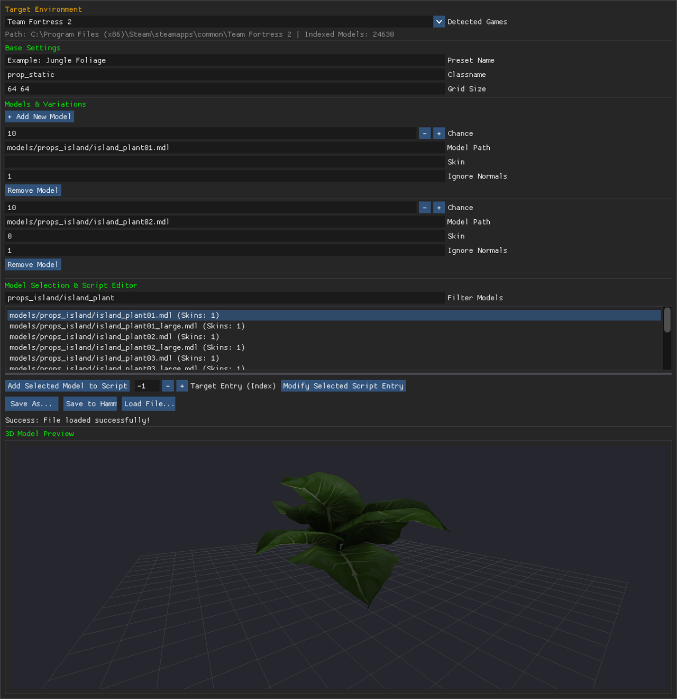

# SprinkleScriptMaker

**SprinkleScriptMaker** is a lightweight C++20 desktop application for creating, editing and exporting preset scripts (`.txt`) for the **Sprinkle Tool** in Valve's Hammer and Hammer++ editors.

Writing Sprinkle presets by hand means typing model paths from memory, guessing skin indices and getting the KeyValues syntax right. SprinkleScriptMaker detects your installed Source Engine games, indexes every model they ship (including models inside VPK archives), lets you preview them in 3D with their real textures and skins, and writes the finished preset straight into Hammer's sprinkle folder.

> **Platform:** Windows only (it uses the Windows Registry to find Steam, and the Win32 OpenGL driver).

<p align="center">
  
</p>
<p align="center"><em>Editing the <code>examples/jungle_foliage.txt</code> preset with Team Fortress 2's models indexed, and <code>island_plant01.mdl</code> in the 3D preview.</em></p>

---

## Table of Contents

- [Features](#-features)
- [Supported Games](#-supported-games)
- [Using the App](#-using-the-app)
- [Sprinkle Script Format](#-sprinkle-script-format)
- [Building from Source](#-building-from-source)
- [Project Structure](#-project-structure)
- [Known Limitations](#-known-limitations)
- [Roadmap](#-roadmap)
- [Built With](#-built-with)
- [License](#-license)

---

## ✨ Features

- **Steam game detection.** Reads the Steam install path from the registry, follows every library in `libraryfolders.vdf` and finds supported games through their `appmanifest_<AppID>.acf` files.
- **Model indexing.** Parses the game's `gameinfo.txt` search paths and scans both loose `models/` folders and VPK archives (including multi-chunk `_dir.vpk` archives) on a background thread pool, so the UI stays responsive.
- **Index cache.** Results are cached on disk under `%TEMP%\SprinkleScriptMaker\AssetIndexCache`. The cache is invalidated automatically when `gameinfo.txt`, a VPK or a model folder changes, so opening a game you've already indexed is close to instant.
- **Garry's Mod content.** Also indexes legacy (folder-based) addons in `garrysmod/addons` and any external game content mounted through `garrysmod/cfg/mount.cfg`.
- **Model browser.** A searchable, filterable list of every indexed model with its skin count. The list only renders visible rows, so it stays fast with tens of thousands of models.
- **Path autocomplete.** Typing in a variation's *Model Path* field shows matching indexed models.
- **3D preview.** Renders the real studio model (`.mdl` + `.vtx` + `.vvd`) with its VTF textures, in an orbit viewport (drag to rotate, scroll to zoom) with a ground grid.
- **Material support in the preview.** Handles common VMT parameters: `$basetexture`, `$translucent`, `$additive`, `$alphatest`, `$nocull`, `$color` / `$color2`.
- **Skin selector.** Models with several skin families get a dropdown so you can preview each skin before picking an index for the preset.
- **Automatic skin defaults.** Models with a single skin get `skin "0"` filled in automatically.
- **Validation.** Model paths must be non-empty and end with `.mdl`. Saving stays disabled until every entry is valid.
- **Load and edit existing presets.** Open any Sprinkle `.txt` file, change it and save it again.
- **Save to Hammer.** Detects 64-bit Hammer++, 32-bit Hammer++ or stock Hammer for the selected game and writes the preset directly into its sprinkle folder (see [Where presets are saved](#where-presets-are-saved)).
- **Crash-resistant model loading.** Corrupt or mismatched model files fail gracefully and show a wireframe placeholder instead of crashing the app (see [`patches/`](patches/README.md)).
- **High-DPI aware.** The interface scales to the Windows display scale.

---

## 🎮 Supported Games

| Game | AppID | Status |
|---|---|---|
| Half-Life 2 | 220 | ✅ |
| Half-Life 2: Episode One | 380 | ✅ |
| Half-Life 2: Episode Two | 420 | ✅ |
| Counter-Strike: Source | 240 | ✅ |
| Day of Defeat: Source | 300 | ✅ |
| Team Fortress 2 | 440 | ✅ |
| Garry's Mod | 4000 | ✅ (includes addons and `mount.cfg`) |
| Left 4 Dead 2 | 550 | ✅ |
| Portal 2 | 620 | ✅ |
| Counter-Strike: Global Offensive (legacy) | 730 / 4465480 | ✅ (see note) |
| Source SDK Base 2013 Singleplayer | 243730 | ✅ |
| Source SDK Base 2013 Multiplayer | 243750 | ✅ |
| Alien Swarm | 630 | 🚧 Work in progress |
| Alien Swarm: Reactive Drop | 563560 | 🚧 Work in progress |
| Counter-Strike 2 | 730 | ❌ Not supported (Source 2) |

**About CS:GO:** AppID 730 now installs Counter-Strike 2 for most players. An install under AppID 730 is only treated as legacy CS:GO if `csgo.exe` still exists in its folder. If both 730 and 4465480 are installed, they're labelled *Original* and *New* in the game list so you can tell them apart.

---

## 🧭 Using the App

1. **Choose a game.** Pick one under *Target Environment → Detected Games*. Indexing starts in the background ("Indexing models...") and the model count appears when it finishes.
2. **Fill in the base settings.**
   - **Preset Name**: the name shown in Hammer's Sprinkle *Type* list (e.g. `Example: Jungle Foliage`).
   - **Classname**: the entity class to place, usually `prop_static`.
   - **Grid Size**: the default sprinkle grid, e.g. `64 64`. You can still change it in Hammer.
3. **Add models.**
   - Search the model list with *Filter Models*, click a model to preview it, then press **Add Selected Model to Script**; or
   - press **+ Add New Model** and type a path into *Model Path* to get autocomplete suggestions.
   - To swap the model of an existing entry, select a model, set **Target Entry (Index)** (0-based) and press **Modify Selected Script Entry**.
4. **Adjust each entry.**
   - **Chance**: the entry's relative weight. Four entries with chance `10` each have a 1-in-4 chance of being placed.
   - **Skin**: the skin index (use the preview's skin selector to find the one you want). Leave it empty to omit the key.
   - **Ignore Normals**: `1` places props upright instead of aligning them to the surface normal, which suits foliage. Leave it empty to omit the key.
5. **Save.**
   - **Save to Hammer** writes the preset straight into the detected editor's sprinkle folder.
   - **Save As...** lets you choose any location.
   - **Load File...** opens an existing preset for editing.

Drag the bar under the model list to resize it. In the 3D preview, hold the left mouse button and drag to rotate, and use the mouse wheel to zoom.

### Where presets are saved

**Save to Hammer** looks for an editor in this order and uses the first one it finds:

| Editor | Executable | Preset folder |
|---|---|---|
| Hammer++ 64-bit | `bin/x64/hammerplusplus.exe` or `bin/win64/...` | `bin/<x64\|win64>/hammerplusplus/scripts/sprinkle/` |
| Hammer++ 32-bit | `bin/hammerplusplus.exe` | `bin/hammerplusplus/scripts/sprinkle/` |
| Stock Hammer | `bin/hammer.exe` | `<game>/scripts/hammer/sprinkle/` |

The file name comes from the preset name, converted to lowercase with underscores (`Example: Jungle Foliage` → `example_jungle_foliage.txt`). The folder is created if it doesn't exist. Restart Hammer (or reopen the Sprinkle tool) to see the new preset.

---

## 📄 Sprinkle Script Format

A Sprinkle preset is a KeyValues file with one `base` block, whose keys every placed entity gets, followed by any number of weighted variations. This is what the app writes (see [`examples/jungle_foliage.txt`](examples/jungle_foliage.txt) for a commented example):

```
"Example: Jungle Foliage"
{
	base
	{
		"classname" "prop_static"
		grid "64 64"
	}

	10
	{
		"model" "models/props_island/island_plant01.mdl"
		"ignorenormals" "1"
	}

	10
	{
		"model" "models/props_island/island_plant02.mdl"
		"skin" "0"
		"ignorenormals" "1"
	}
}
```

| Key | Block | Meaning |
|---|---|---|
| `classname` | `base` | Entity class to place (e.g. `prop_static`). |
| `grid` | `base` | Default grid spacing, `"X Y"`. |
| *number* | root | Relative weight of the variation block that follows. |
| `model` | variation | Game-relative path to the `.mdl`. |
| `skin` | variation | Skin index (optional). |
| `ignorenormals` | variation | `1` keeps props upright regardless of surface angle (optional). |

---

## 🚀 Building from Source

### Prerequisites

- **Windows 10/11, x64**
- **Visual Studio 2022** with the *Desktop development with C++* workload (MSVC with C++20 support)
- **CMake 3.15+** (included with Visual Studio)
- **Git** (required: CMake uses it to fetch dependencies and apply the SourcePP patch)
- An internet connection for the first configure

All other dependencies (SourcePP, GLFW, Dear ImGui) are downloaded automatically by CMake's `FetchContent`.

### Option A: Visual Studio

1. Clone the repository:
   ```bash
   git clone https://github.com/nunozki/SprinkleScriptMaker.git
   ```
2. In Visual Studio, use **File → Open → Folder...** and select the cloned folder. Visual Studio reads `CMakeLists.txt` and configures the project.
3. Choose the `x64-Release` configuration (or `x64-Debug`), select `SprinkleScriptMaker.exe` as the startup item and build.

### Option B: Command line

Run these from a *Developer PowerShell for VS 2022*:

```bash
git clone https://github.com/nunozki/SprinkleScriptMaker.git
```

```bash
cd SprinkleScriptMaker
```

```bash
cmake -S . -B build -G "Visual Studio 17 2022" -A x64
```

```bash
cmake --build build --config Release
```

The executable is written to `build/Release/SprinkleScriptMaker.exe`.

### About the SourcePP patch

During configure, CMake applies [`patches/sourcepp-vtx-bounds-check.patch`](patches/sourcepp-vtx-bounds-check.patch) to the downloaded SourcePP source. It adds bounds checks to the VTX parser, which can otherwise crash the whole process (an uncatchable `0xC0000409`) on malformed models. If configure fails with *"Failed to apply ... patch"*, SourcePP's upstream code has changed. See [`patches/README.md`](patches/README.md) for how to fix it.

---

## 🗂️ Project Structure

```
SprinkleScriptMaker/
├── CMakeLists.txt                  # Build script; fetches dependencies and applies patches
├── examples/
│   └── jungle_foliage.txt          # Commented example Sprinkle preset
├── patches/                        # Patches applied to fetched third-party code
│   ├── README.md
│   ├── apply-sourcepp-patches.cmake
│   └── sourcepp-vtx-bounds-check.patch
├── third_party/
│   └── portable-file-dialogs/      # Native open/save dialogs (single header)
└── src/
    ├── main.cpp                    # Window, ImGui interface and main loop
    ├── sprinkle/
    │   ├── SprinklePreset.h        # SprinklePreset / SprinkleVariation data types
    │   ├── SprinkleReader.h/.cpp   # Parses existing Sprinkle .txt presets
    │   └── SprinkleWriter.h/.cpp   # Generates and saves Sprinkle .txt presets
    ├── platform/
    │   ├── SteamDetector.h/.cpp    # Finds Steam libraries and installed Source games
    │   └── HammerDetector.h/.cpp   # Finds Hammer / Hammer++ and resolves the preset folder
    ├── assets/
    │   └── SourceAssetManager.h/.cpp  # gameinfo.txt parsing, VPK/folder indexing, disk cache
    ├── render/
    │   ├── ModelRenderer.h/.cpp    # Loads .mdl/.vtx/.vvd and VMT/VTF materials, draws the preview
    │   └── ViewportFBO.h/.cpp      # Offscreen framebuffer for the 3D preview
    └── util/
        └── StringUtils.h/.cpp      # Quoted-token parsing shared by the text file readers
```

Each module is a header with declarations only and a `.cpp` with the implementation. Internal helpers and state live in an anonymous namespace in the `.cpp`, so they don't leak into other files. Includes are relative to `src/`, for example `#include "assets/SourceAssetManager.h"`.

---

## ⚠️ Known Limitations

- **Windows only.** Steam detection uses the registry and rendering uses `opengl32` directly.
- **Limited per-variation keys.** Only `model`, `skin` and `ignorenormals` are edited and saved. Other keyvalues in a loaded file (e.g. `modelscale`, `rendercolor`, extra `base` keys) are dropped when you save again.
- **Simple preset reader.** The loader reads files line by line and expects the layout the Sprinkle tool normally uses (one key per line, as in `examples/jungle_foliage.txt`). Unusual formatting may not load correctly.
- **Garry's Mod `.gma` addons aren't indexed.** Only folder-based addons in `garrysmod/addons` are scanned. Workshop `.gma` packages aren't read.
- **Alien Swarm** and **Alien Swarm: Reactive Drop** support is still in progress.
- **Source 2 isn't supported** (Counter-Strike 2, Half-Life: Alyx, etc.).
- **Simplified preview.** It uses fixed-function OpenGL with basic lighting. It doesn't reproduce normal maps, phong, envmaps or other advanced shaders.

---

## 🛣️ Roadmap

- [x] KeyValues `.txt` script generation
- [x] Loading and editing existing presets
- [x] GUI for base parameters, models, chances and skins
- [x] Steam game detection and model indexing (loose files and VPK)
- [x] 3D model preview with textures and a skin selector
- [x] Saving directly to Hammer / Hammer++
- [ ] Full Alien Swarm / Reactive Drop support
- [ ] Preserve and edit arbitrary keyvalues (`modelscale`, `rendercolor`, `angles`, ...)
- [ ] Indexing of Garry's Mod `.gma` addons
- [ ] Manually adding custom games or mods that aren't on Steam
- [ ] Drag-and-drop reordering of entries and a live preview of the script text

---

## 🛠️ Built With

- **C++20**
- **[SourcePP](https://github.com/craftablescience/sourcepp)**: Valve file formats (VPK, MDL/VTX/VVD, VTF, KeyValues)
- **[Dear ImGui](https://github.com/ocornut/imgui)**: immediate-mode GUI
- **[GLFW](https://github.com/glfw/glfw)**: window and OpenGL context
- **[portable-file-dialogs](https://github.com/samhocevar/portable-file-dialogs)**: native file dialogs
- **OpenGL**: 3D preview
- **CMake**: build system

---

## 📜 License

Released under the [MIT License](LICENSE).

Not affiliated with or endorsed by Valve Corporation. *Source*, *Hammer* and the game names above are trademarks of Valve Corporation. Hammer++ is a third-party project by its own authors.
